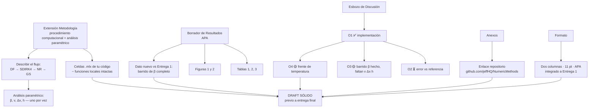

---
tags:
  - metodos-numericos
  - CC2104
  - guia
  - avance3
titulo: Avance 3 — Implementación Computacional y Borrador de Resultados
origen: Enunciado de la asignatura (sección 5.3)
vinculado:
  - "[[MN P2 - Esquema Grupo 4]]"
  - "[[MN P2 - Esquema.canvas]]"
---

# 5.3. Avance 3 — Implementación Computacional y Borrador de Resultados

> [!info] Qué es este avance
> Es el **paso previo a la entrega final** (Paso Previo a Entrega Final).
> No es el paper definitivo: es un **draft sólido** que valida el enfoque **antes** de consolidar el artículo académico.

---

## 1. ¿Cuál es su propósito?

Dos cosas a la vez:

1. **Fase de ejecución computacional** → correr el código realmente.
2. **Análisis preliminar de los datos** → mirar qué salió y empezar a interpretarlo.

> [!note] Posición en el cronograma
> Es un **paso intermedio y obligatorio**: no es opcional. Sirve para **validar el enfoque** antes de escribir la versión definitiva del paper.

---

## 2. Qué hay que entregar (Contenido)

Tres bloques:

| # | Bloque | Qué incluye |
|---|---|---|
| **A** | **Extensión de la Metodología** | Detallar el **procedimiento computacional** y el **análisis paramétrico** |
| **B** | **Primer borrador de Resultados** | Figuras y tablas **preliminares en formato APA** |
| **C** | **Esbozo inicial de la Discusión** | Empezar a **relacionar los hallazgos empíricos con los objetivos específicos** |

### ❌ Lo que NO se pide todavía
> [!warning] Excepción explícita
> **No se exige redactar las conclusiones definitivas** en esta etapa.

### Traducción a lo que ya tienes en el PDF

- **A (Metodología):** las secciones 5.1–5.5 de tu nota → diferencias finitas, SDIRK4, Newton-Raphson, Gauss-Seidel, criterios de convergencia… pero ahora **escrito como procedimiento computacional**, es decir, *qué hace el código paso a paso*, no solo la matemática. Más el **análisis paramétrico** (variar β, v, Δx, h de uno en vez).
- **B (Resultados):** Tablas 1, 2, 3 y Figuras 1 y 2, **preliminares** y en APA.
- **C (Discusión):** tu sección 4 → vincular hallazgos con O1, O2, O3, O4.
- **Conclusiones:** se dejan para la entrega final.

---

## 3. Requisitos (lo que se evalúa)

### 3.1 Código funcional en `.mlx`
> [!important] Requisito duro
> **Implementación funcional** de los métodos numéricos en archivos **`.mlx` (MATLAB Live Scripts)**.

### 3.2 ⚠️ Restricción crítica: no tocar las funciones locales
> [!danger] Asegúrese **estrictamente**
> Al estructurar el código, **NO modificar las funciones locales incluidas en las plantillas**.
>
> En la práctica: las funciones que vienen ya escritas en la plantilla `.mlx` se copian y se usan **tal cual**. Tu código va en las celdas de script que te tocan a ti. Si las modificas, incumples el requisito aunque el resultado sea correcto.

### 3.3 Anexo con enlace al repositorio
Hay que incluir en los **Anexos** un **enlace preliminar y accesible** al repositorio en la nube con los avances del código.

> [!tip] Ya lo tienes
> En tu PDF (Anexos) figura: `https://github.com/jeffHQ/NumericMethods`
> ✔️ Cumple: es **preliminar** (avances) y **accesible** (en la nube).

---

## 4. Formato

| Aspecto | Requisito |
|---|---|
| **Integración** | Las nuevas secciones se integran **al documento de la primera entrega** (mismo archivo, no otro) |
| **Formato** | Artículo académico a **dos columnas** |
| **Fuente** | **11 pt** |
| **Rol del documento** | Un **borrador sólido (draft)** previo a la entrega final |
| **Figuras/Tablas** | Formato **APA** |

> [!warning] Ojo con esto
> No se entrega un documento aparte: se **extiende el paper de la Entrega 1** manteniendo dos columnas y 11 pt.

---

## 5. Checklist de cumplimiento

### Contenido
- [ ] Metodología extendida con el **procedimiento computacional**
- [ ] Metodología extendida con el **análisis paramétrico**
- [ ] Borrador de **Resultados** con figuras y tablas preliminares en **APA**
- [ ] **Esbozo** de Discusión que relacione hallazgos ↔ objetivos específicos
- [ ] **No** redactar conclusiones definitivas (todavía)

### Requisitos
- [ ] Código `.mlx` **funcional**
- [ ] **No modificar** las funciones locales de las plantillas
- [ ] **Anexo** con enlace preliminar y accesible al repositorio

### Formato
- [ ] Integrado al documento de la **Entrega 1**
- [ ] **Dos columnas**, fuente **11 pt**
- [ ] Figuras y tablas en formato **APA**
- [ ] Todo el documento lee como un **draft** sólido

---

## 6. Mapa: encargo → tu trabajo actual

---

## 7. Brecha detectada en tu avance actual

Comparando el enunciado con el PDF que ya tienes (`MN_P2_Grupo_4.pdf`):

| Requisito 5.3 | Estado | Acción |
|---|---|---|
| Código `.mlx` funcional | 🟡 Existe repo | Verificar que esté completo |
| No modificar funciones locales | ❓ | Revisar plantillas |
| Anexo con enlace de repositorio | ✅ | Ya está |
| Extender Metodología (proced. computacional) | 🟡 | Falta detalle *computacional* |
| Análisis paramétrico completo | 🟡 | Solo β hecho; **faltan v, Δx, h** |
| Borrador Resultados en APA | 🟡 | Tablas/Figs. tienen que ir en APA |
| Esbozo de Discusión ↔ objetivos | ✅ | Sección 4 ya lo hace |
| **No** escribir conclusiones | ✅ | No las hay |
| Dos columnas 11 pt integrado a Entrega 1 | ✅ | Ya en ese formato |

### Pendientes críticos (de tu propia sección 4)
- [ ] **Error máximo** vs. solución de referencia → *bloquea O2*
- [ ] Barridos de **v, Δx, h** → *bloquea O3*
- [ ] **x_f por código** en cada instante (no leerlo de la figura) → *bloquea O4*

> [!tip] Síntesis
> **Avance 3 = correr el código + mostrar resultados preliminares + empezar a discutir.**
> Lo que te falta de fondo es el **análisis paramétrico completo** y el **error vs. referencia**; lo que te falta de forma es **APA** y el **detalle computacional** de la metodología.

---

#CC2104 #avance3 #draft #MATLAB #mlx #APA
