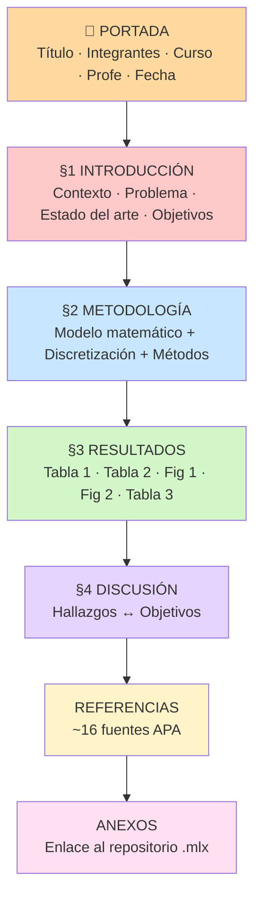

---
tags:
  - metodos-numericos
  - CC2104
  - guia
  - paper
  - estructura
titulo: Componentes y estructura del paper — Avance 3
fuente: "[[MN_P2_Grupo_4.pdf]]"
vinculado:
  - "[[MN P2 - Esquema Grupo 4]]"
  - "[[5.3 Avance 3 - Implementación y Borrador de Resultados]]"
  - "[[Resumen de exposicion - Avance 3]]"
---

# 🧩 Componentes y estructura del paper

> [!info] Qué es este documento
> Guía que explica **cada componente** del paper `MN_P2_Grupo_4.pdf` (8 páginas) y **cómo se organiza**. Sirve para entender qué va en cada parte y por qué.

---

## 1. Primero: qué tipo de paper es

Es un **artículo académico a dos columnas, fuente 11 pt**, siguiendo la estructura **IMRaD**:

| Sigla | Significado      | ¿Dónde está en nuestro paper?            |
| ----- | ---------------- | ---------------------------------------- |
| **I** | **I**ntroduction | §1 Introducción                          |
| **M** | **M**ethods      | §2 Metodología                           |
| **R** | **R**esults      | §3 Resultados *(implícito en el cuerpo)* |
| **a** | **a**nd          | —                                        |
| **D** | **D**iscussion   | §4 Discusión                             |

Y alrededor: **portada**, **referencias** y **anexos**.

> [!note] Dato importante
> En nuestro PDF los números de sección van **1, 2, (3), 4** — el **§3 de Resultados no está numerado explícitamente** pero existe como bloque de resultados (Tablas 1-3, Figuras 1-2). Eso es normal en borradores.

---

## 2. Mapa completo de la estructura



---

## 3. Componente por componente

### 📄 A. Portada (pág. 1)

| Elemento | Contenido |
|---|---|
| **Título** | Modelamiento numérico transitorio del transporte de calor 1D en el flujo sobre un tubo cilíndrico con difusividad térmica variable |
| **Integrantes** | Calapuja Quispe · Dongo Triveño · Hilario Quintana · Zorrilla Pelaez (con código) |
| **Asignatura** | Métodos Numéricos (CC2104) |
| **Docente** | Ponce Cegovia, Roger Ivan |
| **Fecha de entrega** | 18/10/2026 |

> [!tip] Anatomía del título
> 1. **Qué se hace:** *Modelamiento numérico transitorio*
> 2. **De qué:** *transporte de calor 1D*
> 3. **Dónde:** *flujo sobre un tubo cilíndrico*
> 4. **La particularidad:** *con difusividad térmica variable*
>
> El título ya dice el problema, la dimensión, el escenario y la dificultad.

---

### §1. INTRODUCCIÓN (pág. 2–3)

Es el embudo: **de lo general a lo específico**.

| Párrafo | Función | Contenido concreto |
|---|---|---|
| **1.1 Contexto** | *¿Por qué importa?* | Transporte de calor en fluidos: enfriamiento industrial, intercambiadores de calor, turbomaquinaria |
| **1.2 El fenómeno** | *¿Qué pasa físicamente?* | **Advección** (el fluido arrastra T) + **difusión** (T se reparte) |
| **1.3 La dificultad** | *¿Por qué es duro?* | α cambia con T → ecuación **no lineal** → casi nunca hay solución exacta |
| **1.4 El escenario** | *¿Dónde?* | Flujo sobre tubo cilíndrico, régimen estacionario y transitorio (Singh et al., 2025) |
| **1.5 La simplificación** | *Cómo lo abordamos* | Formulación **1D** sobre una línea de corriente; **v es dato**, no se resuelve el flujo |
| **1.6 Estado del arte** | *Qué hizo el resto* | Wang 2022 (Kirchhoff), Ejaz 2024 (colocación), Aznam 2019 (wavelets Haar), Filipov 2023 (implícito), Deng 2014 / Levý & May 2022 (Runge-Kutta) |
| **1.7 Objetivos** | *Qué hago yo* | 1 general + 4 específicos (ver abajo) |

#### Los 4 objetivos específicos (componente clave)

> [!important] Son la **columna vertebral** de TODO el paper
> La Discusión (§4) se organiza **exactamente** alrededor de estos 4.

| # | Objetivo | Qué hay que entregar |
|---|---|---|
| **O1** | Formular e implementar: **DF + SDIRK4 + Newton-Raphson + Gauss-Seidel**, con Dirichlet y error vs. referencia | Código `.mlx` funcional |
| **O2** | Evaluar el modelo con parámetros base y Dirichlet, midiendo el **error máximo** vs. solución de referencia | Un número de error |
| **O3** | Analizar robustez variando **β, v, Δx, h** → error, iteraciones, tiempo de cómputo | 4 barridos |
| **O4** | Aplicar al calentamiento transitorio y cuantificar la **posición del frente** x_f en distintos instantes | x_f(t) |

---

### §2. METODOLOGÍA (pág. 3–5) — *el corazón técnico*

Es la sección más larga y se divide en **4 sub-bloques**:

#### A. El modelo matemático

**Ecuación (1)** — advección–difusión transitoria:
```
∂T/∂t + v ∂T/∂x = ∂/∂x [ α(T) ∂T/∂x ]
```

**Ecuación (2)** — difusividad variable (aquí entra la no linealidad):
```
α(T) = α₀ [ 1 + β (T − T₀) ]
```

| Componente | Significado físico | Rol en la ecuación |
|---|---|---|
| `∂T/∂t` | cambio en el tiempo | hace el problema **transitorio** |
| `v ∂T/∂x` | el fluido **arrastra** el calor | **advección** |
| `∂/∂x[α ∂T/∂x]` | el calor **se reparte** | **conducción/difusión** |
| `α(T)` | difusividad que cambia con T | **fuente de no linealidad** |
| `β` | cuánto cambia α con T | si `β=0` → caso **lineal** |

> [!tip] El desarrollo clave
> Desarrollando el lado derecho: `α(T)·T_xx + α₀β·T_x²`
> → ese `α₀β·T_x²` es lo que hace no lineal a la ecuación.

#### B. Dominio, condiciones y supuestos

| Componente | Detalle |
|---|---|
| **Dominio** | `x ∈ [0, L]`, una línea de corriente: corriente libre (x=0) → pared del tubo (x=L) |
| **Malla** | N nodos equiespaciados, `Δx = L/(N−1)` |
| **Condición de frontera** | **Dirichlet**: `T(0,t)=T₁` y `T(L,t)=T_N` (extremos fijos) |
| **Condición inicial** | `T(x,0) = T_N` en todo el tramo, **excepto** `x=0` donde `T=T₁` |
| **Supuesto 1** | Reducción a **1D** (sin variación transversal) |
| **Supuesto 2** | `v` **conocida y constante** → el flujo no se resuelve |

#### C. Los 3 métodos numéricos (encadenados)

> [!quote] Orden de aplicación (literal del paper)
> *"El espacio se discretiza con diferencias finitas → SDIRK4 avanza la solución paso a paso → en cada etapa Newton-Raphson resuelve la no linealidad → en cada iteración de Newton, Gauss-Seidel resuelve el sistema lineal."*


**① Diferencias finitas** → **Ecuación (6)**
- Difusión **conservativa**: α evaluada en puntos medios `α_{i±1/2} = ½[α(T_i)+α(T_{i±1})]`
- Advección: **diferencias centradas**
- Nodos extremos se mantienen fijos (Dirichlet)
``` 
f_i = [α_{i+1/2}(T_{i+1}−T_i) − α_{i−1/2}(T_i−T_{i−1})]/Δx² − v(T_{i+1}−T_{i−1})/(2Δx)
```

**② Newton-Raphson** → **Ecuación (4)** + **Ecuación (7)**
```
x^(k+1) = x^(k) − [J(x^(k))]⁻¹ F(x^(k))
```
- El **Jacobiano J es tridiagonal** (cada nodo solo depende de sus vecinos) → bajo costo
- **Ecuación (7)** = las tres entradas `∂f_i/∂T_{i−1}`, `∂f_i/∂T_i`, `∂f_i/∂T_{i+1}`
- Con β=0 se reduce a la matriz constante del caso lineal
- Justificación: converge rápido si el inicial está cerca (Deuflhard, 1974)

**③ SDIRK4** → **Ecuación (5)** + **Ecuación (8)**
```
T^(n+1) = T^n + h Σ_{i=1..5} b_i f(U_i)          (5)
r_i = T^n + h Σ_{j<i} a_ij f(U_j)                (8)
```
- **S**ingly **D**iagonally **I**mplicit **R**unge-**K**utta, 4to orden, **5 etapas**
- Coeficientes `a_ij`, `b_i` de la literatura (Wang 2015; Butcher 1996)
- **Implícito** → permite h mayores (Deng 2014; Levý & May 2022)

**④ Gauss-Seidel** → resuelve el sistema lineal **dentro de cada iteración de Newton**

#### D. Parámetros de control

| Componente | Valor |
|---|---|
| Máx. iteraciones Newton-Raphson | **20** |
| Máx. iteraciones Gauss-Seidel | **500** (en todas las NR de la etapa) |
| Tiempo final | **0,5 s** (para que el frente quede dentro del dominio) |
| Definición del frente x_f | primer nodo con `T ≤ 50 °C` + **interpolación lineal** con el anterior |
| Solución de referencia | mismo método con **malla mucho más fina** y **h mucho menor**, comparada en nodos comunes |

---

### §3. RESULTADOS (pág. 5–7)

Tiene **5 componentes**: una tabla de parámetros, una tabla de resultados base, dos figuras y una tabla de barrido.

#### 📊 Tabla 1 — Parámetros del caso base
> *Dónde se fija todo lo que se va a correr.*

| Parámetro | Símbolo | Valor |
|---|---|---|
| Longitud | L | 1 m |
| Nodos | N | 51 |
| Velocidad | v | 0,5 m/s |
| Difusividad ref. | α₀ | 0,01 m²/s |
| Coef. variación | β | 0,2 |

#### 📈 Figura 1 — Perfil de temperatura en t = 0,5 s
> *Un "snapshot" del resultado final.* Línea discontinua = 50 °C.

#### 📈 Figura 2 — Evolución del perfil entre t = 0,1 y t = 0,5 s
> *Cinco curvas superpuestas* → muestra **cómo se mueve y suaviza** el frente con el tiempo.

#### 📊 Tabla 2 — Resultados del caso base
> *Las "métricas" de la corrida.*

| Resultado | Valor |
|---|---|
| Tiempo simulado | 0,5 s (50 pasos = **250 etapas**) |
| Iteraciones Newton-Raphson | **787** (≈3,15/etapa) |
| Iteraciones Gauss-Seidel | **9 140** (≈11,6 por NR) |
| Etapas sin convergencia | **0 / 0** |
| Posición del frente x_f | **0,4739 m** |

#### 📊 Tabla 3 — Barrido del coeficiente β
> *El análisis paramétrico (O3), solo para β.*

| β | x_f (m) | Iter. N-R | Iter. G-S | Tiempo (s) |
|---|---|---|---|---|
| 0 | 0,2670 | 500 | 1 925 | 0,70 |
| 0,1 | 0,3965 | 774 | 6 372 | 2,13 |
| 0,2 | 0,4739 | 787 | 9 140 | 3,39 |
| 0,4 | 0,5882 | 811 | 14 294 | 5,07 |

> [!warning] Componente faltante
> **No hay tabla/figura de error vs. solución de referencia** → eso es el **O2**, y sigue pendiente.

---

### §4. DISCUSIÓN (pág. 7)

> [!important] Regla de oro de la discusión
> **No repite los resultados: los INTERPRETA y los liga a los objetivos.**

Se organiza **objetivo por objetivo**:

| Bloque | Qué dice |
|---|---|
| **↔ O1** | El esquema se implementó y **no hubo etapas sin convergencia**. Newton promedió 3,1 iter/etapa (esperable, Deuflhard 1974); Gauss-Seidel 11,6 por Newton. |
| **↔ O2** | Menciona la Figura 2 (se desplaza y ensancha, sin oscilaciones) pero reconoce: ***"queda pendiente cuantificar el error frente a una solución referencial"*** |
| **↔ O3** | Reporta el barrido de β completo. Para β=0, x_f ≈ advección pura `v·t = 0,25 m`. **"Los barridos de v, Δx y h quedan pendientes."** |
| **↔ O4** | x_f estimada en 5 instantes (0,17→0,47 m); velocidad del frente **cae de 0,9 a 0,6 m/s**. **"Queda pendiente calcular la posición con el código, en lugar de leerla de la figura."** |

**Componente tipográfico:** el paper usa **cursiva** en los verbos de encuadre: *"se plantean"*, *"se repitió"*, *"queda pendiente"*.

---

### 📚 REFERENCIAS (pág. 7–8)

Formato **APA**. Fuentes agrupadas por rol:

| Rol | Fuentes |
|---|---|
| **Contexto físico (CFD)** | Singh et al. (2025) |
| **No linealidad / conducción con propiedades variables** | Wang & Zheng (2022) · Filipov et al. (2023) · Aznam et al. (2019) · Ejaz et al. (2024) |
| **Runge-Kutta implícitos (SDIRK)** | Wang (2015) · Deng et al. (2014) · Levý & May (2022) · Butcher (1996) |
| **Newton-Raphson** | Deuflhard (1974) |
| **Gauss-Seidel** | Zhang et al. (2015) |
| **Convección-difusión IMEX** | Bevan et al. (2016) · Boscarino et al. (2015) |

---

### 📎 ANEXOS (pág. 8)

Componente **obligatorio del Avance 3**:

> **Repositorio del código.** Los archivos `.mlx` de la implementación están disponibles en:
> `https://github.com/jeffHQ/NumericMethods`

✔️ Cumple el requisito: **preliminar** (avances) y **accesible** (en la nube).

---

## 4. Tabla resumen: componente → página → función

| # | Componente | Pág. | Función en el paper |
|---|---|---|---|
| 1 | Portada | 1 | Identificar qué, quién, cuándo |
| 2 | §1 Introducción | 2–3 | Vender el problema y declarar objetivos |
| 3 | §2 Metodología | 3–5 | Explicar el modelo + cómo se resuelve numéricamente |
| 4 | §3 Resultados | 5–7 | Mostrar Tablas 1-3 y Figuras 1-2 |
| 5 | §4 Discusión | 7 | Interpretar ↔ objetivos + declarar pendientes |
| 6 | Referencias | 7–8 | Respaldar cada decisión (APA) |
| 7 | Anexos | 8 | Probar que el código existe (enlace repo) |

---

## 5. Las "piezas" recurrentes que se repiten

Aprende a identificarlas en cualquier paper IMRaD:

```mermaid
graph TD
    E[ECUACIONES numeradas<br/>1,2 = modelo · 4 = Newton · 5,8 = SDIRK4 · 6,7 = DF/Jacobiano] --> X
    T[TABLAS con Nota al pie<br/>T1 parámetros · T2 resultados · T3 barrido] --> X
    F[FIGURAS con Nota al pie<br/>F1 snapshot · F2 evolución] --> X
    O[OBJETIVOS numerados<br/>O1-O4 = se repiten en Discusión] --> X
    C[CITAS parentéticas<br/>(Autor, año) en todo el texto] --> X
    P[PÁRRAFOS de PENDIENTE<br/>'queda pendiente ...'] --> X
    X[📄 ESTRUCTURA COHERENTE]
```

---

## 6. Lo que está incompleto (borrador = Avance 3)

- [ ] **§2** detalle **computacional** del procedimiento y **análisis paramétrico completo**
- [ ] **§3** falta el **error vs. referencia** (O2) y los barridos de **v, Δx, h** (O3)
- [ ] **§3** figuras y tablas en formato **APA**
- [ ] **§4** falta x_f **por código** en cada instante (O4)
- [ ] **No** hay conclusiones definitivas → *correcto, para esta etapa*

---

#CC2104 #paper #estructura #IMRaD #guia
