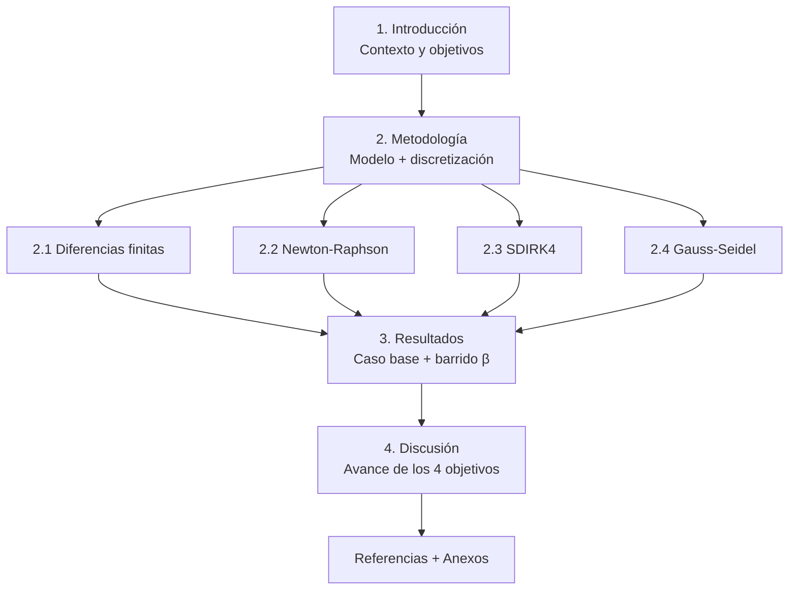
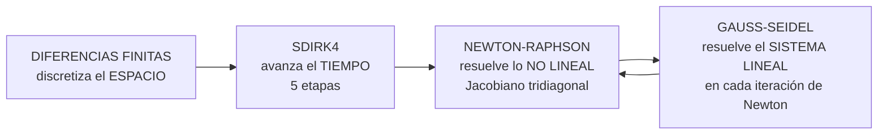
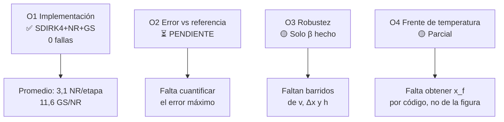

---
tags:
  - metodos-numericos
  - P2
  - esquema
curso: CC2104 Métodos Numéricos
docente: Ponce Cegovia, Roger Ivan
fecha_entrega: 2026-10-18
grupo: "Grupo 4"
fuente: "[[MN_P2_Grupo_4.pdf]]"
---

# Esquema — Modelamiento numérico transitorio del transporte de calor 1D

> [!info] Documento fuente
> **Título:** Modelamiento numérico transitorio del transporte de calor 1D en el flujo sobre un tubo cilíndrico con difusividad térmica variable
> **Integrantes:** Calapuja Quispe (202310600) · Dongo Triveño (202310506) · Hilario Quintana (202020082) · Zorrilla Pelaez (202510379)
> **Código:** [[https://github.com/jeffHQ/NumericMethods|Repositorio .mlx]]

---

## 1. Idea central (una línea)

Resolver numéricamente la ecuación de **advección–difusión 1D transitoria** con **difusividad térmica variable** α(T) sobre una línea de corriente que va de la corriente libre (x=0) hasta la pared de un tubo cilíndrico (x=L), usando **Diferencias Finitas + SDIRK4 + Newton-Raphson + Gauss-Seidel**.

---

## 2. Estructura del paper

---

## 3. Planteamiento del problema

### 3.1 Ecuación gobernada

$$\frac{\partial T}{\partial t} + v\frac{\partial T}{\partial x} = \frac{\partial}{\partial x}\left[\alpha(T)\frac{\partial T}{\partial x}\right] \tag{1}$$

$$\alpha(T) = \alpha_0\left[1 + \beta\,(T - T_0)\right] \tag{2}$$

| Símbolo | Significado |
|---|---|
| `x ∈ [0, L]` | posición sobre la línea de corriente |
| `t` | tiempo (problema **transitorio**) |
| `v` | velocidad del fluido (dato **constante**, no se resuelve el flujo) |
| `α₀` | difusividad térmica a T₀ |
| `β` | coeficiente de variación de la difusividad → **fuente de no linealidad** |

> [!note] Clave de la no linealidad
> Desarrollando el lado derecho: `α(T)·T_xx + α₀β·T_x²`.
> Si **β = 0** → caso lineal (difusividad constante).

### 3.2 Condiciones y dominio

- **Dirichlet:** `T(0,t) = T₁`  y  `T(L,t) = T_N`
- **Inicial:** `T(x,0) = T_N` en todo el tramo, salvo `x = 0` donde `T = T₁`
- **Malla:** N nodos equiespaciados, `Δx = L/(N−1)`

### 3.3 Supuestos

1. Reducción a **1D** (línea de corriente, sin variación transversal).
2. Velocidad `v` conocida y constante → el flujo **no se resuelve**.

---

## 4. Los 4 objetivos específicos

| # | Objetivo | Estado (según paper) |
|---|---|---|
| **O1** | Formular e implementar el modelo: **DF + SDIRK4 + Newton-Raphson + Gauss-Seidel**, con Dirichlet y error vs. solución de referencia | ✅ Implementado, 0 etapas sin convergencia |
| **O2** | Evaluar el caso base midiendo el **error máximo** vs. referencia | ⚠️ Parcial — *falta cuantificar el error* |
| **O3** | Analizar robustez variando **β, v, Δx, h** (error, iteraciones, tiempo de cómputo) | ⚠️ Solo **β** hecho; *faltan v, Δx, h* |
| **O4** | Aplicar al calentamiento transitorio y cuantificar la **posición del frente** x_f | ⚠️ Parcial — *falta calcular x_f por código en cada instante* |

---

## 5. Metodología — la cadena de métodos

> [!quote] Orden de aplicación (del paper)
> *"El espacio se discretiza con diferencias finitas → SDIRK4 avanza la solución → en cada etapa Newton-Raphson resuelve la no linealidad → en cada iteración de Newton, Gauss-Seidel resuelve el sistema lineal."*

### 5.1 Diferencias finitas (espacio)

- Difusión **conservativa**: difusividad evaluada en puntos medios `α_{i±1/2} = ½[α(T_i) + α(T_{i±1})]`
- Advección: **diferencias centradas**

$$f_i = \frac{\alpha_{i+1/2}(T_{i+1}-T_i) - \alpha_{i-1/2}(T_i-T_{i-1})}{\Delta x^2} - v\frac{T_{i+1}-T_{i-1}}{2\Delta x} \tag{6}$$

- Nodos extremos `T₁`, `T_N` fijos (Dirichlet)

### 5.2 Newton-Raphson (no linealidad)

$$x^{(k+1)} = x^{(k)} - \left[J(x^{(k)})\right]^{-1}F(x^{(k)}) \tag{4}$$

- **J es tridiagonal** (cada nodo solo depende de sus vecinos) → bajo costo
- Entradas del jacobiano: ec. **(7)** (términos `∂f_i/∂T_{i-1}`, `∂f_i/∂T_i`, `∂f_i/∂T_{i+1}`)
- Para β=0 el jacobiano reduce a la matriz constante del caso lineal

### 5.3 SDIRK4 (tiempo) — 5 etapas

$$T^{n+1} = T^n + h\sum_{i=1}^{5} b_i f(U_i) \tag{5}$$

$$r_i = T^n + h\sum_{j<i} a_{ij} f(U_j) \tag{8}$$

- Coeficientes `a_ij`, `b_i` tomados de la literatura (Wang 2015; Butcher 1996)
- Carácter **implícito** → permite pasos de tiempo mayores
- Cada etapa exige resolver una ecuación no lineal `G(U_i)=0` → por eso NR + GS

### 5.4 Gauss-Seidel (sistema lineal)

- Resuelve el sistema lineal **dentro de cada iteración de Newton**

### 5.5 Criterios de convergencia

| Método | Máximo | Criterio de no convergencia |
|---|---|---|
| Newton-Raphson | **20** iteraciones | llegó a 20 |
| Gauss-Seidel | **500** iteraciones | llegó a 500 en **todas** las NR de esa etapa |

---

## 6. Caso base — Tabla 1

| Parámetro | Símbolo | Valor |
|---|---|---|
| Longitud del dominio | L | 1 m |
| Número de nodos | N | 51 (Δx = 0,02 m) |
| Velocidad del fluido | v | 0,5 m/s |
| Difusividad de referencia | α₀ | 0,01 m²/s |
| Coeficiente de variación | β | 0,2 |
| Paso de tiempo | h | 0,01 s (50 pasos → t_f = 0,5 s) |

> [!tip] Definición del frente
> `x_f` = punto donde **T alcanza (T₁+T_N)/2 = 50 °C** → primer nodo con T ≤ 50 + **interpolación lineal** con el nodo anterior.

---

## 7. Resultados

### 7.1 Caso base — Tabla 2

| Resultado | Valor |
|---|---|
| Tiempo simulado | 0,5 s (50 pasos = 250 etapas) |
| Iteraciones Newton-Raphson | **787** (≈ 3,15 / etapa) |
| Iteraciones Gauss-Seidel | **9 140** (≈ 11,6 / cada NR) |
| Etapas sin convergencia | **0 / 0** |
| Posición del frente x_f | **0,4739 m** |

**Figura 1** — Perfil de temperatura en t = 0,5 s · **Figura 2** — Evolución t = 0,1 → 0,5 s

- Sin oscilaciones visibles; T = 100 °C en x=0 y 0 °C lejos de la corriente caliente
- El perfil se desplaza hacia la pared y se **suaviza** con el tiempo
- Frente en t = 0,1…0,5 s ≈ **0,17 / 0,26 / 0,34 / 0,41 / 0,47 m**
- El frente **nunca alcanza** la pared en t = 0,5 s

> [!warning] Observación clave
> El avance del frente **decrece** con el tiempo: ~0,09 m en el primer intervalo → ~0,06 m en el último.
> Velocidad del frente: **~0,9 m/s → ~0,6 m/s**

### 7.2 Barrido de β — Tabla 3

| β | x_f (m) | Iter. N-R | Iter. G-S | Tiempo (s) |
|---|---|---|---|---|
| 0 | 0,2670 | 500 | 1 925 | 0,70 |
| 0,1 | 0,3965 | 774 | 6 372 | 2,13 |
| 0,2 | 0,4739 | 787 | 9 140 | 3,39 |
| 0,4 | 0,5882 | 811 | 14 294 | 5,07 |

**Lecturas principales:**

- ✅ **x_f crece monótonamente con β**: +48 %, +77 %, **+120 %** respecto al caso lineal
- Físicamente coherente: al subir β, la difusividad crece con T → la zona caliente conduce mejor (`α(100 °C) = 21 α₀` con β = 0,2)
- ✅ **N-R**: 500 (lineal, 2,0/etapa) → 774–811 (no lineal, 3,1–3,2/etapa). *Salto grande de β=0→0,1, casi nulo de 0,1→0,4* → **prácticamente no depende de la intensidad de la no linealidad**
- ✅ **G-S crece sostenido**: 3,9 → 8,2 → 11,6 → 17,6 iteraciones por cada N-R
- ✅ **Tiempo ×7,2** (0,70 → 5,07 s) → el costo creciente se debe al **Gauss-Seidel**, no a Newton-Raphson
- ✅ **Cero** etapas sin convergencia con cualquier β
- 📌 Para β=0, x_f ≈ 0,267 m ≈ advección pura `v·t = 0,25 m`

---

## 8. Discusión vs. objetivos

**Resumen del avance:** el esquema converge siempre; aumentar β desplaza el frente más lejos y encarece el cómputo, principalmente por Gauss-Seidel.

---

## 9. Pendientes (para el siguiente avance)

- [ ] Calcular el **error máximo** frente a la solución de referencia (O2)
- [ ] Barridos de **v**, **Δx** y **h** (O3)
- [ ] Obtener **x_f por código** en cada instante, en lugar de leerlo de la figura (O4)
- [ ] Comparar con resultados publicados / discutir estabilidad

---

## 10. Referencias clave citadas

- **Butcher (1996)** — métodos de Runge-Kutta
- **Wang (2015)** — SDIRK4 de cuarto orden para Burgers 1D
- **Deng et al. (2014)** — DIRK para convección-difusión dependiente del tiempo
- **Levý & May (2022)** — DIRK más estables/precisos que BDF de alto orden
- **Deuflhard (1974)** — convergencia de Newton
- **Wang & Zheng (2022)** — transformada de Kirchhoff + método sin malla
- **Filipov et al. (2023)** — discretización implícita con conductividad dependiente de T
- **Singh et al. (2025)** — CFD del flujo sobre tubo cilíndrico (contexto físico)
- **Zhang et al. (2015)** — convergencia de Gauss-Seidel con matrices H

---

## 11. Notación rápida

| Elemento | Qué es |
|---|---|
| `f_i` | RHS del nodo interior i (ec. 6) |
| `J_f` | Jacobiano **tridiagonal** (ec. 7) |
| `U_i` | temperatura en la etapa i de SDIRK4 |
| `r_i` | predictor de la etapa i (ec. 8) |
| `G(U_i)=0` | ecuación no lineal de la etapa i |
| `x_f` | posición del frente (T = 50 °C) |
| `α_{i±1/2}` | difusividad en el punto medio |

---

#esquema #calor #SDIRK4 #newton-raphson #gauss-seidel #diferencias-finitas
